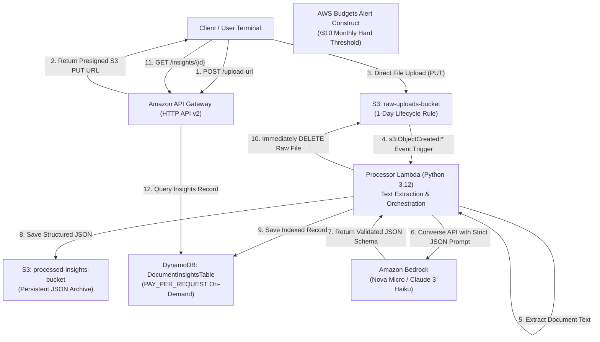

# AI Document Analyzer (AWS Serverless)

A production-ready, ultra-low-cost document intelligence pipeline built on AWS. Analyzes uploaded documents (PDF, TXT, JSON, Markdown, CSV), extracts **ONLY** key structured information using **Amazon Bedrock** (Nova Micro / Claude 3 Haiku), stores the extracted data persistently in **Amazon DynamoDB** and **Amazon S3**, and automatically sanitizes/deletes the original raw files.

---

## Architecture Overview



---

## Strict Budget Guardrails & Cost Breakdown

This architecture is engineered from the ground up for a **strict $100 budget limit**, ensuring operational expenses remain at fractions of a cent per document.

### Cost Analysis per 1,000 Documents Analyzed

| Service | Configuration & Usage | Cost per 1,000 Requests |
| :--- | :--- | :--- |
| **Amazon Bedrock (Nova Micro)** | ~800 input tokens ($0.000035/1k) + ~250 output tokens ($0.00014/1k) | **$0.063** |
| **AWS Lambda (Python 3.12)** | 512 MB memory, ~1,500 ms execution time (750 GB-s) | **$0.013** |
| **Amazon DynamoDB** | On-Demand (`PAY_PER_REQUEST`): 1,000 Writes + 1,000 Reads | **$0.0015** |
| **Amazon S3 (API & Storage)** | 1,000 PUTs + 1,000 DELETEs; immediate raw cleanup; ~2 MB insights | **$0.005** |
| **Amazon API Gateway (HTTP API)** | 2,000 requests (Presigned URL + Query) at $1.00/million | **$0.002** |
| **TOTAL ESTIMATED COST** | **1,000 full document processing cycles** | **~$0.085 USD** |

> [!TIP]
> **Total cost is under \$0.09 per 1,000 documents** (over 5x lower than the \$0.50 threshold).
> Even analyzing **100,000 documents** would consume only **~\$8.50**, remaining well within the \$100 budget limit.

### Key Cost Optimizations Applied:
1. **Ultra-Low-Cost LLM Engine**: Defaults to `amazon.nova-micro-v1:0` ($0.000035 / 1k input tokens, $0.00014 / 1k output tokens) or `anthropic.claude-3-haiku-20240307-v1:0`. No expensive models (Opus, Sonnet) are used.
2. **DynamoDB On-Demand (`PAY_PER_REQUEST`)**: Zero provisioned throughput charges. You pay $0.00 when idle.
3. **Double S3 Cleanup Mechanism**:
   - **Immediate Deletion**: The Lambda function deletes the source raw file from `raw-uploads-bucket` the moment extraction succeeds.
   - **1-Day Lifecycle Rule**: Automatic S3 expiration purges any failed, aborted, or orphaned uploads after 24 hours.
4. **AWS Budget Construct**: Integrated AWS Budget (`MonthlyCostBudget`) configured with an alert threshold at **$10.00** actual spend and **80% ($8.00)** forecasted spend.
5. **Direct S3 Presigned Uploads**: Large payloads bypass Lambda and API Gateway memory, eliminating compute transfer costs and memory bloat.

---

## Prerequisites (Local Machine)

No AWS CloudShell is required. The entire workflow is scaffolded, built, tested, and deployed locally via your terminal.

- **Node.js**: v18+ (tested with v20/v24 LTS)
- **Python**: 3.12+ (local runtime matches Lambda environment)
- **AWS CLI**: v2 (`aws --version`)
- **AWS Credentials**: An IAM User or Role with permissions to deploy CloudFormation, S3, DynamoDB, Lambda, Bedrock, and API Gateway.

---

## Local Setup & Configuration

### 1. Configure Local AWS Credentials
Run `aws configure` in your terminal to set your active credentials:

```bash
aws configure
# AWS Access Key ID [None]: YOUR_ACCESS_KEY
# AWS Secret Access Key [None]: YOUR_SECRET_KEY
# Default region name [None]: us-east-1
# Default output format [None]: json
```

Verify your active credentials:
```bash
aws sts get-caller-identity
```

### 2. Enable Amazon Bedrock Model Access
1. Open the [AWS Bedrock Console](https://console.aws.amazon.com/bedrock/).
2. Select your target region (e.g., `us-east-1` or `us-west-2`).
3. In the left navigation menu, click **Model access**.
4. Click **Modify model access**, check **Amazon: Nova Micro** (and/or **Anthropic: Claude 3 Haiku**), and click **Next** -> **Submit**. Access is granted immediately.

### 3. Configure Environment Variables
Copy `.env.example` to `.env` and adjust if needed:

```bash
cp .env.example .env
```

Key environment options in `.env`:
- `AWS_PROFILE`: Your AWS CLI profile name (`default`).
- `AWS_REGION`: Target AWS region (`us-east-1`).
- `BEDROCK_MODEL_ID`: Default `amazon.nova-micro-v1:0` (or `anthropic.claude-3-haiku-20240307-v1:0`).
- `BUDGET_LIMIT`: Monthly cost alert threshold in USD (default `10`).
- `ALERT_EMAIL`: Email address to receive AWS Budget threshold notifications.

---

## Local Deployment

Deploy the entire infrastructure directly using the included deployment script or standard CDK commands. **Zero Docker dependency is required.**

### Option A: Using Deployment Script

**Windows (PowerShell):**
```powershell
.\deploy.ps1
```

**Linux / macOS / Git Bash:**
```bash
chmod +x deploy.sh
./deploy.sh
```

### Option B: Manual Step-by-Step CDK Commands

```bash
# 1. Install dependencies
npm install

# 2. Run unit tests locally
python -m unittest tests/unit/test_prompt_and_extractor.py

# 3. Synthesize CloudFormation template
npx cdk synth

# 4. Bootstrap CDK environment (first time in region only)
npx cdk bootstrap

# 5. Deploy stack to AWS
npx cdk deploy --require-approval never
```

Upon completion, CDK outputs the live HTTP API endpoint:
```text
Outputs:
AiDocumentAnalyzerStack.ApiEndpoint = https://xxxxxxxxxx.execute-api.us-east-1.amazonaws.com
AiDocumentAnalyzerStack.RawUploadsBucketName = aidocumentanalyzerstack-rawuploadsbucketxxxxxx
AiDocumentAnalyzerStack.ProcessedInsightsBucketName = aidocumentanalyzerstack-processedinsightsbucketxxxxxx
AiDocumentAnalyzerStack.DocumentInsightsTableName = AiDocumentAnalyzerStack-DocumentInsightsTablexxxxxx
```

---

## End-to-End Testing with cURL

Save your API endpoint to an environment variable for testing:
```bash
export API_URL="https://xxxxxxxxxx.execute-api.us-east-1.amazonaws.com"
# On Windows PowerShell:
# $API_URL = "https://xxxxxxxxxx.execute-api.us-east-1.amazonaws.com"
```

### Step 1: Verify API Health Check
```bash
curl -s -X GET "$API_URL/health"
```
**Response:**
```json
{
  "status": "healthy",
  "service": "ai-document-analyzer",
  "model_id": "amazon.nova-micro-v1:0",
  "raw_bucket": "aidocumentanalyzerstack-rawuploadsbucket...",
  "table": "AiDocumentAnalyzerStack-DocumentInsightsTable..."
}
```

---

### Step 2: Request a Presigned S3 Upload URL
Request a direct S3 PUT URL for your document:

```bash
curl -s -X POST "$API_URL/upload-url" \
  -H "Content-Type: application/json" \
  -d '{"filename": "sample_contract.txt", "content_type": "text/plain"}'
```

**Response:**
```json
{
  "document_id": "8f48b11c-2234-4ce1-8637-295304a9d701",
  "filename": "sample_contract.txt",
  "s3_key": "raw/8f48b11c-2234-4ce1-8637-295304a9d701/sample_contract.txt",
  "upload_url": "https://aidocumentanalyzerstack-rawuploadsbucket....s3.amazonaws.com/raw/8f48b11c-2234-4ce1-8637-295304a9d701/sample_contract.txt?X-Amz-Algorithm=...",
  "expires_in_seconds": 900,
  "method": "PUT"
}
```

Copy the `document_id` and `upload_url` from the response.

---

### Step 3: Direct Client Upload to S3
Upload the file directly to S3 using the presigned `upload_url`:

```bash
curl -X PUT -T "test_samples/sample_contract.txt" \
  -H "Content-Type: text/plain" \
  "<UPLOAD_URL_FROM_STEP_2>"
```

> [!NOTE]
> The S3 upload immediately triggers `s3:ObjectCreated:*` -> the Processor Lambda executes -> extracts text -> queries Amazon Bedrock -> writes clean JSON to DynamoDB and S3 -> immediately deletes the raw source file from S3!

---

### Step 4: Query Extracted Insights
Fetch the extracted structured intelligence:

```bash
curl -s -X GET "$API_URL/insights/<DOCUMENT_ID_FROM_STEP_2>"
```

**Extracted JSON Output:**
```json
{
  "document_id": "8f48b11c-2234-4ce1-8637-295304a9d701",
  "filename": "sample_contract.txt",
  "status": "COMPLETED",
  "classification": "CONTRACT",
  "summary": "Master Services Agreement between Apex Cloud Systems LLC and Meridian Healthcare Inc. for a serverless data ingestion pipeline and HIPAA-compliant archival storage on AWS, with a fixed fee of $45,000 USD and monthly support of $3,200 USD.",
  "action_items": [
    "Meridian Healthcare must provide IAM cross-account role access by October 25, 2026",
    "Apex Cloud will deliver the Architecture Design Document (ADD) by November 02, 2026",
    "Mutual review of Disaster Recovery RTO/RPO metrics scheduled for November 10, 2026",
    "Complete final acceptance testing by December 15, 2026"
  ],
  "key_entities": [
    {"name": "Apex Cloud Systems LLC", "category": "ORGANIZATION", "context": "Service Provider"},
    {"name": "Meridian Healthcare Inc.", "category": "ORGANIZATION", "context": "Client"},
    {"name": "$45,000 USD", "category": "CURRENCY", "context": "Fixed Engineering Fee"},
    {"name": "$3,200 USD/month", "category": "CURRENCY", "context": "Managed Support Fee"},
    {"name": "October 25, 2026", "category": "DATE", "context": "IAM access deadline"}
  ],
  "model_id": "amazon.nova-micro-v1:0",
  "input_tokens": 312,
  "output_tokens": 164,
  "raw_file_deleted": true,
  "created_at": "2026-10-18T08:50:12.341512+00:00"
}
```

---

### Step 5: List Recent Insights
```bash
curl -s -X GET "$API_URL/insights?limit=10"
```

---

## Directory Structure

```text
.
├── bin/
│   └── app.ts                         # AWS CDK entrypoint with env loader
├── lib/
│   ├── ai-document-analyzer-stack.ts  # Main CDK Stack (S3, DynamoDB, Lambda, API Gateway)
│   └── constructs/
│       └── budget-alert.ts            # AWS Budget Construct ($10 alert threshold)
├── src/
│   ├── lambda/
│   │   ├── __init__.py
│   │   ├── handler.py                 # S3 Event Processor Lambda (Bedrock + DynamoDB + S3)
│   │   ├── api_handler.py             # API Gateway HTTP Router (Presigned URL + Insights API)
│   │   ├── text_extractor.py          # Zero-dependency text extractor (TXT, JSON, CSV, PDF)
│   │   └── requirements.txt           # Local reference dependencies
│   └── prompts/
│       ├── __init__.py
│       └── extraction_prompt.py       # Strict JSON schema system prompt & parser
├── frontend/                          # Modern web dashboard (HTML5, Tailwind, Lucide, JS)
│   ├── index.html                     # Single-page application UI
│   ├── app.js                         # AWS API integration, presigned S3 uploads & polling
│   └── styles.css                     # Custom animations & glassmorphism styling
├── run_frontend.py                    # One-click local web dashboard launcher
├── test_client.py                     # Interactive zero-dependency CLI test client
├── test_samples/
│   ├── generate_sample_pdf.py         # Pure-Python test PDF generator
│   ├── sample_quarterly_report.pdf    # Real-world financial report PDF sample
│   ├── sample_contract.txt            # Real-world contract test sample
│   └── sample_meeting_notes.txt       # Real-world meeting notes test sample
├── tests/
│   └── unit/
│       ├── test_prompt_and_extractor.py # Local prompt & text extraction tests (TXT, JSON, PDF)
│       └── test_end_to_end_mock.py      # End-to-end mocked workflow tests (zero AWS credentials needed)
├── .env.example                       # Environment configuration template
├── .gitignore
├── cdk.json                           # AWS CDK configuration
├── package.json                       # Node dependencies and build scripts
├── tsconfig.json                      # TypeScript configuration
├── deploy.sh                          # Local bash deployment pipeline
├── deploy.ps1                         # Local PowerShell deployment pipeline
└── README.md                          # Production architectural guide
```

---

## Web Dashboard (Modern Frontend UI)

A modern, responsive, zero-build web dashboard is included in [`frontend/`](file:///c:/Users/Manas%20Mishra/OneDrive/Desktop/AWS%20Project/frontend/index.html). It connects directly to your live AWS API Gateway and S3 infrastructure.

### Launch the Frontend:
Run the launcher script in your terminal:
```bash
python run_frontend.py
# Or via npm:
npm run frontend
```
*This starts a local server at `http://localhost:3000` and automatically opens the dashboard in your default browser.*

### Dashboard Features:
- **Drag-and-Drop Uploader**: Upload `.pdf`, `.txt`, `.json`, `.csv`, `.md` documents directly to S3.
- **One-Click Sample Loaders**: Test with pre-loaded legal contracts or financial reports with a single click.
- **Live Pipeline Tracker**: Real-time visual status across the 4 stages: API Gateway Presigned URL $\rightarrow$ S3 Streaming $\rightarrow$ Bedrock Nova Analysis $\rightarrow$ DynamoDB Archival & S3 Cleanup.
- **Executive Summary Card**: Formatted summary with a one-click copy button.
- **Interactive Action Items**: Clickable checklist where you can check off action items in real-time.
- **Key Entities Explorer**: Tagged entities categorized by Organization, Product, Currency, Date, Person, Location.
- **DynamoDB History Explorer**: Searchable and filterable sidebar showing all past analyzed documents.
- **Dual View**: Toggle between structured visual cards and syntax-highlighted raw JSON.
- **Live AWS Health Indicator**: Continuously monitors API Gateway connectivity and latency.

---

## Alternative: Interactive CLI Test Client (`test_client.py`)

As a cross-platform alternative to cURL, use the included [`test_client.py`](file:///c:/Users/Manas%20Mishra/OneDrive/Desktop/AWS%20Project/test_client.py) (uses pure Python standard library, zero dependencies):

```bash
# 1. Check API Health
python test_client.py health

# 2. Upload and analyze a document (polls until Bedrock analysis is complete!)
python test_client.py upload test_samples/sample_quarterly_report.pdf
# Or TXT:
python test_client.py upload test_samples/sample_contract.txt

# 3. Retrieve insights by ID
python test_client.py get <DOCUMENT_ID>

# 4. List recent document extractions
python test_client.py list
```

---

## Clean Up / Teardown

To tear down all deployed resources and prevent any future AWS charges:

```bash
npx cdk destroy --force
```

This will automatically remove the API Gateway, Lambda functions, DynamoDB tables, S3 buckets, and CloudFormation stacks.
